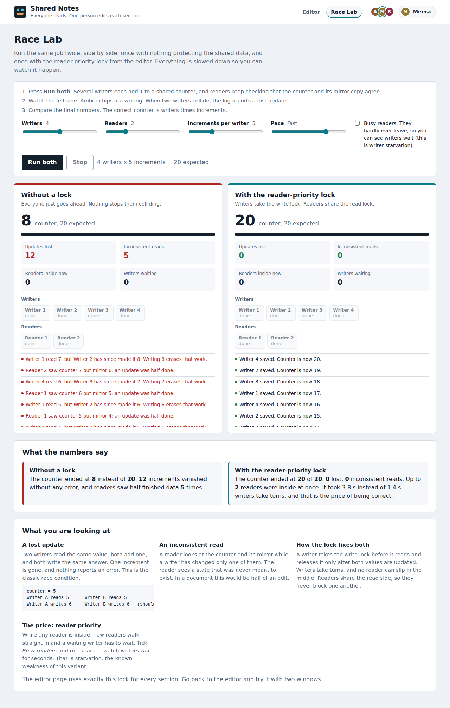
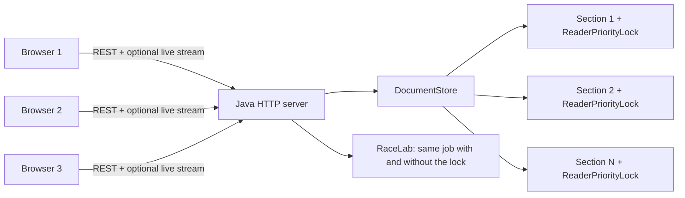

# Shared Notes: a collaborative editor built on the Readers-Writers problem

A small Google-Docs-style web app whose behaviour is controlled by a classic operating-system
synchronization technique: the **Readers-Writers problem with reader priority**, written in
**pure Java** (standard library only, no frameworks, no build tool).

* Many people can **read** the same section at the same time.
* Only **one** person can **edit** a given section at a time.
* Readers are never blocked by other readers, and they overtake a writer that is only *waiting*.
* Changes appear on everyone's screen live, with the names of the people who are here.
* A built-in **Race Lab** and a narrated **loaddemo.bat** show, slowly and visibly, what goes wrong *without* the lock and how the lock prevents it.

Built for the SPOS (System Programming and Operating Systems) mini project by two team members.

| Editor | Race Lab |
|---|---|
|  |  |

---

## 1. How the OS concept maps to the code

| Textbook idea | Where it lives |
|---|---|
| `mutex` semaphore protecting `readCount` | `ReaderPriorityLock.mutex` |
| `wrt` semaphore (one writer, or the whole group of readers) | `ReaderPriorityLock.wrt` |
| `readCount` | `ReaderPriorityLock.readCount` |
| Reader entry / exit | `readLock()` / `readUnlock()` |
| Writer entry / exit | `tryWriteLock(ms)` / `writeUnlock()` |
| Critical section (the actual change) | the two lines in `Section.commit()` that set `text` and `version` |
| Race condition without the lock | `RaceLab` (unsafe run): lost updates and inconsistent reads |
| Starvation of writers (the price of reader priority) | Race Lab with **Busy readers** ticked |



### Two layers of protection (why editing does not freeze readers)

If a writer held the write lock for the whole time a person is typing, every reader would freeze for minutes.
So each section uses two layers:

1. **Edit claim (ownership).** Pressing *Edit* asks for an exclusive claim on that section. It never blocks:
   if someone else holds it you are told who. The claim is a 60-second *lease* that the browser renews every
   15 s, so a closed tab cannot lock a section forever.
2. **Reader-priority write lock.** Pressing *Save* takes the write lock only for the instant the text
   is replaced. Readers keep seeing the last saved version while you type and are held back only during that instant.

---

## 2. Project structure and who owns what

```
spos-collab-editor/
├── src/com/spos/editor/
│   ├── ReaderPriorityLock.java   A  the semaphore algorithm
│   ├── Section.java              A  claim / lease / commit / snapshot
│   ├── DocumentStore.java        A  sections, activity log, save and load
│   ├── RaceLab.java              A  the same workload with and without the lock
│   ├── LabService.java           A  runs Race Lab sessions for the browser
│   ├── LoadDemo.java             A  narrated console demo (loaddemo.bat)
│   ├── LockDemo.java             A  console timeline of reader priority
│   ├── SelfTests.java            A  30 automated checks
│   ├── ApiHandler.java, Broadcaster.java, StaticHandler.java, Presence.java,
│   │   Config.java, Util.java, Server.java        A  web layer and wiring
│   ├── StressTest.java           B  in-process stress test
│   └── HttpLoadTest.java         B  fast load test against a running server
├── static/                       B  index.html, lab.html, style.css, app.js, lab.js, common.js, config.js
├── Dockerfile                    B  optional container build
├── .github/workflows/ci.yml      B  automatic build + tests on GitHub
├── build.bat run.bat test.bat demo.bat loaddemo.bat loadtest.bat   Windows helpers
├── scripts/*.sh                  Linux / macOS helpers
├── .vscode/                      VS Code tasks, launch configs, settings
└── docs/                         demo guide, test cases, team workflow, viva questions, screenshots
```

Both members should be able to explain the whole system. See [docs/DEMO_GUIDE.md](docs/DEMO_GUIDE.md) for a presenter script,
[docs/TEAM_WORKFLOW.md](docs/TEAM_WORKFLOW.md) for branches and commits, and [docs/VIVA_QUESTIONS.md](docs/VIVA_QUESTIONS.md) for practice questions.

---

## 3. Setup on Windows 11 with VS Code (step by step)

### 3.1 Install the tools (one time)

Open **Windows Terminal** or **PowerShell** and run:

```powershell
winget install EclipseAdoptium.Temurin.17.JDK
winget install Microsoft.VisualStudioCode
winget install Git.Git
```

Close and reopen the terminal, then check:

```powershell
java -version
javac -version
git --version
```

Both Java commands must print version 17 or higher. If `javac` is not recognised, you installed only a JRE or
the terminal was not reopened. Reinstall the **JDK** and open a new terminal. Docker is **not** needed.

### 3.2 Open the project in VS Code

1. Unzip `spos-collab-editor.zip` to a short path such as `C:\projects\spos-collab-editor`.
2. Start VS Code, choose **File > Open Folder**, and select the `spos-collab-editor` folder.
3. When VS Code asks *"Do you want to install the recommended extensions?"*, click **Install**. This installs the
   **Extension Pack for Java**. Wait until the spinner at the bottom of the window stops.
4. Open `src/com/spos/editor/Server.java`. You should see **Run | Debug** above `main`. If VS Code asks which JDK to use, pick 17.

### 3.3 Run the application

| Way | Steps |
|---|---|
| **F5** | Press **F5**, choose **Run Server (press F5)**. |
| **Task** | **Terminal > Run Task... > Run server** |
| **Terminal** | Open **Terminal > New Terminal** and run `.\run.bat` |

You should see `Shared Notes is running.` Open <http://localhost:8080>. Windows may show a firewall prompt the first time;
choose **Private networks**. To act as a second user, open another window (a private window works well) and enter another name.
Each tab keeps its own name, so two tabs of the same browser also work as two users.

### 3.4 Run the tests and demos

| What | Command | What you see |
|---|---|---|
| **Guided demo (slow, narrated)** | `.\loaddemo.bat` | Press Enter between four scenes. Add `--auto` to skip the waiting. |
| All automated tests | `.\test.bat` | `30 passed, 0 failed`, then `RESULT: PASS` |
| Reader-priority timeline only | `.\demo.bat` | A later reader overtakes a waiting writer |
| Fast load test (server must be running) | `.\loadtest.bat http://localhost:8080 30 6 8` | Thousands of requests in seconds, then `RESULT: PASS` |

`loadtest.bat` is meant to be fast: it is a benchmark. `loaddemo.bat` is the one to present, because it slows everything down and explains it.

### 3.5 Common problems

| Problem | Fix |
|---|---|
| `javac is not recognized` | Install the JDK (not a JRE), reopen the terminal. Check `JAVA_HOME` if you have several JDKs. |
| `Port 8080 already in use` | `set PORT=9090` then `.\run.bat`, and open `http://localhost:9090`. |
| `release version 17 not supported` | Your JDK is older than 17. Install JDK 17 or newer. |
| VS Code shows red squiggles on correct code | **Ctrl+Shift+P > Java: Clean Java Language Server Workspace**, then reload. |
| Header shows "Reconnecting" | The live stream is unavailable (server stopped, or a tunnel that does not stream). The page keeps working by polling about once a second. |
| Page looks stale after editing `static/` files | Hard refresh with **Ctrl+F5**. |

---

## 4. Showing that it prevents race conditions (the demo)

Full presenter script: [docs/DEMO_GUIDE.md](docs/DEMO_GUIDE.md). The short version:

1. **`loaddemo.bat`**: four slow, narrated scenes in the console.
   *Scene 1* runs 4 writers adding to a shared counter **without a lock** and shows lost updates (for example a final value of 9 instead of 20, with no error reported).
   *Scene 2* runs the **same job with the lock**: 20 of 20, nothing lost, readers never see half-finished data.
   *Scene 3* shows reader priority as a timeline. *Scene 4* has eight users claim one section at the same instant over HTTP and exactly one wins.
2. **Race Lab** (the **Race Lab** link in the page header): the same experiment in the browser, side by side, with moving chips for every reader and writer,
   live counters, a log of each collision, and a plain-language verdict. Tick **Busy readers** to see writers starve.
3. **Editor + Slow motion**: two windows, claim the same section, watch the lock, then slow saves down and watch the rail turn solid amber.

How to explain data consistency in one sentence: *every change to a section happens while holding the write lock, so no other writer
can interleave and no reader can look in the middle; the tests count lost updates and inconsistent reads and both are zero with the lock.*

---

## 5. Tests

* `SelfTests` has 30 checks: the lock (readers share, a reader overtakes a waiting writer, a writer excludes readers, timeouts), claims, commits,
  lease expiry and heartbeat, **Race Lab** (updates are lost without the lock, none with it), helpers, and saving and loading the data file.
* `StressTest`, part 1: two plain, unprotected integers that writers update one after the other while readers check they are always equal.
  Part 2: several writers fight over one section and **successful commits must equal the final version number**.
* `HttpLoadTest` does the same over HTTP against a running server and compares the growth of the version numbers with the number of `200 OK` commits.

Table: [docs/TEST_CASES.md](docs/TEST_CASES.md). GitHub runs the build and tests on every push (`.github/workflows/ci.yml`).

---

## 6. HTTP API

| Endpoint | Method | Parameters | Result |
|---|---|---|---|
| `/api/doc` | GET | none | All sections (text, version), read through each section's read lock. |
| `/api/status` | GET | none | Non-blocking lock state per section, people here, activity log, config. |
| `/api/events` | GET | none | Optional live stream (Server-Sent Events): `event: doc` and `event: status`. |
| `/api/claim` | POST | `user`, `section` | `200` granted, `409` locked (with `holder`). |
| `/api/renew` | POST | `user`, `section` | `200` renewed, `403` expired. |
| `/api/release` | POST | `user`, `section` | `200`, cancels editing. |
| `/api/commit` | POST | `user`, `section`, `text` | `200` saved, `403` no claim, `503` readers kept it busy, `413` too long. |
| `/api/hello` | POST | `user` | Says "I am here" (people list). |
| `/api/config` | POST | `user`, `readHoldMs`, `writeHoldMs` | Slow-motion settings (0 to 5000 ms). |
| `/api/reset` | POST | `user` | Restores the original text. |
| `/api/lab/start` | POST | `writers`, `readers`, `ops`, `step`, `busy` | Starts a Race Lab run, returns its `id`. |
| `/api/lab/poll` | GET | `id`, `since` | Events, live numbers and, at the end, the results. |
| `/api/lab/stop` | POST | `id` | Cancels a run. |
| `/api/health` | GET | none | Health check. |

Names must be 1 to 20 letters, digits, spaces, dots, dashes or underscores. Section text is limited to 5000 characters.

---

## 7. Configuration (environment variables)

| Variable | Default | Meaning |
|---|---|---|
| `PORT` | `8080` | HTTP port |
| `DATA_FILE` | `data/document.db` | Where text is saved. `none` disables saving. |
| `STATIC_DIR` | `static` | Folder with the browser files |
| `LEASE_SECONDS` | `60` | Edit-claim lease |
| `WRITE_WAIT_MS` | `5000` | How long a save waits for readers before `503` |
| `READ_HOLD_MS`, `WRITE_HOLD_MS` | `0` | Slow motion at startup |
| `ALLOWED_ORIGIN` | `*` | CORS origin if the frontend is hosted separately |

PowerShell example: `$env:PORT=9090; .\run.bat`  |  Command Prompt: `set PORT=9090` then `run.bat`.

---

## 8. Making it public for free (no Docker, no card needed)

A Java server cannot run on GitHub Pages (that only hosts static files), and free Docker hosting has become unreliable
(see 8.4). The simplest honest approach for a viva is to **run the server on your own laptop** and let people reach it.

### 8.1 Same Wi-Fi or phone hotspot (best for a live viva)

Run `ipconfig`, find your **IPv4 Address** (for example `192.168.1.23`), start the server, and open
`http://192.168.1.23:8080` on any phone or laptop on the same network. Allow Java through the firewall on **Private networks**.
No account, no internet, nothing to install.

### 8.2 A public https link with ngrok (free account, no card)

```powershell
winget install Ngrok.Ngrok
ngrok config add-authtoken <your-token-from-the-ngrok-dashboard>
ngrok http 8080
```

Share the `https://...ngrok...` address it prints. The live stream works through it. Free-plan limits and terms change, so check ngrok's current terms.

### 8.3 A public https link with Cloudflare Quick Tunnel (no account)

```powershell
winget install Cloudflare.cloudflared
cloudflared tunnel --url http://localhost:8080
```

Share the `https://...trycloudflare.com` address. Cloudflare's documentation says quick tunnels do not support Server-Sent Events,
so the header will show "Reconnecting". **The app still works**: it automatically polls about once a second, and the Race Lab already uses polling.

While you share a link, your laptop must stay awake and the server must keep running. Anyone with the link can use the app, so stop the tunnel when you are done.

### 8.4 About free cloud hosting

When I checked in October 2026, several sources reported that Render and Koyeb now ask for a card, that Fly.io is no longer free, and that
Hugging Face Docker Spaces moved to a paid plan; a few smaller hosts advertise card-free free tiers but I have not verified them.
Policies change often. A `Dockerfile` is included (`docker build -t spos-collab-editor .` then `docker run --rm -p 8080:8080 spos-collab-editor`)
in case you or your college already have a hosting account. For the project it is optional.

---

## 9. Publishing to GitHub (two-person workflow)

```powershell
cd C:\projects\spos-collab-editor
git init
git add .
git commit -m "Initial project import"
git branch -M main
git remote add origin https://github.com/<your-username>/spos-collab-editor.git
git push -u origin main
```

Then Person B accepts the invitation (Settings > Collaborators), clones the repo, and each person works on their own branch:

```powershell
git checkout -b feature/<short-name>
git add .
git commit -m "Describe what changed"
git push -u origin feature/<short-name>
```

Open a Pull Request, let the other person review, and merge. Details and a starter commit plan are in [docs/TEAM_WORKFLOW.md](docs/TEAM_WORKFLOW.md).

---

## 10. Known limitations

* **Writer starvation** is inherent to reader priority: under a constant stream of readers a save can time out with `503`. The Race Lab shows it on purpose.
* Locking is per section, not per character, so two people cannot type in the same paragraph together.
* No accounts: names are self-declared and can be impersonated. The demo controls (slow motion, reset) are open to everyone who can reach the server.
* Text is kept in memory and in one small file on the host.
* One server process only; this is a teaching project for tens of users, not thousands.

## 11. Future scope

Writer-priority or fair variants (compare them in the Race Lab), a database, real login and roles,
WebSockets, character-level co-editing (Operational Transformation or CRDTs), version history with undo, and a distributed lock for several servers.

## 12. References

1. Silberschatz, Galvin, Gagne, *Operating System Concepts*, Wiley. Process Synchronization: the Readers-Writers problem.
2. Tanenbaum, Bos, *Modern Operating Systems*, Pearson. Classical IPC problems.
3. Courtois, Heymans, Parnas, "Concurrent Control with 'Readers' and 'Writers'", *Communications of the ACM* 14(10), 1971.
4. Oracle, Java SE 17 API: `java.util.concurrent.Semaphore`, `com.sun.net.httpserver`.
5. MDN Web Docs, *Using server-sent events*.
6. Cloudflare Docs, *Quick Tunnels* (limitations).

## License

MIT, see [LICENSE](LICENSE). Replace the names in the license with your own.
