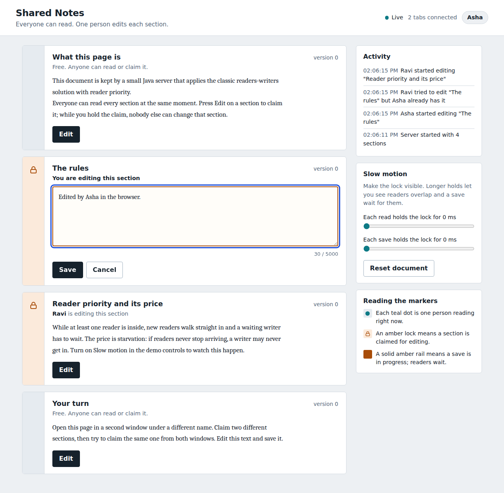
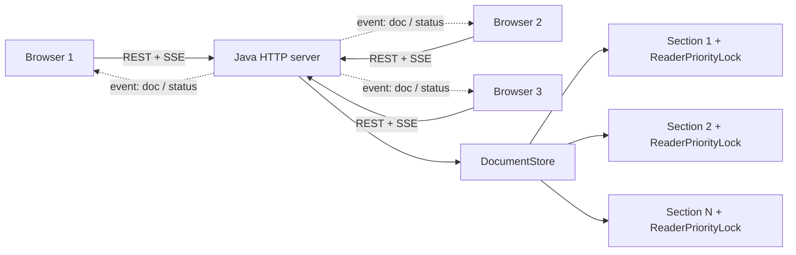

# Shared Notes: a collaborative editor built on the Readers-Writers problem

A small Google-Docs-style web app whose behaviour is controlled by a classic operating-system
synchronization technique: the **Readers-Writers problem with reader priority**, written in
**pure Java** (standard library only, no frameworks, no build tool).

* Many people can **read** the same section at the same time.
* Only **one** person can **edit** a given section at a time.
* Readers are never blocked by other readers, and they overtake a writer that is only *waiting*.
* Changes appear on everyone's screen live.

Built for the SPOS (System Programming and Operating Systems) mini project by two team members.



---

## 1. How the OS concept maps to the code

| Textbook idea | Where it lives |
|---|---|
| `mutex` semaphore protecting `readCount` | `ReaderPriorityLock.mutex` |
| `wrt` semaphore (one writer, or the whole group of readers) | `ReaderPriorityLock.wrt` |
| `readCount` | `ReaderPriorityLock.readCount` |
| Reader entry / exit | `readLock()` / `readUnlock()` |
| Writer entry / exit | `tryWriteLock(ms)` / `writeUnlock()` |
| Critical section (the actual change) | the two lines in `Section.commit()` that set `text` and `version` |
| Starvation of writers (the price of reader priority) | visible with the **Slow motion** sliders in the UI |



### Two layers of protection (why editing does not freeze readers)

If a writer held the write lock for the whole time a person is typing, every reader would freeze for minutes.
So each section uses two layers:

1. **Edit claim (ownership).** Pressing *Edit* asks for an exclusive claim on that section. It is
   non-blocking: if someone else holds it you are told who. The claim is a 60-second *lease* that the
   browser renews every 15 s, so a closed tab cannot lock a section forever.
2. **Reader-priority write lock.** Pressing *Save* takes the write lock only for the instant the text
   is replaced. Readers keep seeing the last saved version while you type and are held back only during that instant.

---

## 2. Project structure and who owns what

```
spos-collab-editor/
├── src/com/spos/editor/
│   ├── ReaderPriorityLock.java   Person A  the semaphore algorithm
│   ├── Section.java              Person A  claim / lease / commit / snapshot
│   ├── DocumentStore.java        Person A  sections, activity log, save and load
│   ├── Config.java               Person A  settings
│   ├── Util.java                 Person A  JSON, form parsing, validation
│   ├── ApiHandler.java           Person A  REST endpoints
│   ├── Broadcaster.java          Person A  Server-Sent Events hub
│   ├── StaticHandler.java        Person A  serves the browser files safely
│   ├── Server.java               Person A  entry point
│   ├── SelfTests.java            Person A  27 automated checks
│   ├── LockDemo.java             Person A  console demo of reader priority
│   ├── StressTest.java           Person B  in-process stress test
│   └── HttpLoadTest.java         Person B  load test against a running server
├── static/                       Person B  index.html, style.css, app.js, config.js
├── Dockerfile, render.yaml       Person B  deployment
├── .github/workflows/ci.yml      Person B  automatic build + tests on GitHub
├── build.bat run.bat test.bat demo.bat loadtest.bat    Windows helpers
├── scripts/*.sh                  Linux / macOS helpers
├── .vscode/                      VS Code tasks, launch configs, settings
└── docs/                         test cases, team workflow, viva questions, screenshots
```

Both members should be able to explain the whole system. See [docs/TEAM_WORKFLOW.md](docs/TEAM_WORKFLOW.md)
for the suggested branches and commits for each person and [docs/VIVA_QUESTIONS.md](docs/VIVA_QUESTIONS.md) for practice questions.

---

## 3. Setup on Windows 11 with VS Code (step by step)

### 3.1 Install the tools (one time)

Open **Windows Terminal** or **PowerShell** and run:

```powershell
winget install EclipseAdoptium.Temurin.17.JDK
winget install Microsoft.VisualStudioCode
winget install Git.Git
```

Close and reopen the terminal, then check:

```powershell
java -version
javac -version
git --version
```

Both Java commands must print version 17 or higher. If `javac` is not recognised, you installed only a JRE or
the terminal was not reopened. Reinstall the **JDK** and open a new terminal.

Optional: Docker Desktop (`winget install Docker.DockerDesktop`) if you want to test the container locally.

### 3.2 Open the project in VS Code

1. Unzip `spos-collab-editor.zip` to a short path such as `C:\projects\spos-collab-editor`.
2. Start VS Code, choose **File > Open Folder**, and select the `spos-collab-editor` folder.
3. When VS Code asks *"Do you want to install the recommended extensions?"*, click **Install**. This installs the
   **Extension Pack for Java** (`vscjava.vscode-java-pack`). Wait until the status bar at the bottom stops showing a spinner.
4. Open `src/com/spos/editor/Server.java`. You should see **Run | Debug** above `main`. If VS Code asks which JDK to use, pick 17.

### 3.3 Run the application

Pick **one** of these:

| Way | Steps |
|---|---|
| **F5** | Press **F5**, choose **Run Server (press F5)**. |
| **Task** | **Terminal > Run Task... > Run server** |
| **Terminal** | Open **Terminal > New Terminal** and run `.\run.bat` |

You should see:

```
Build OK. Classes are in the "out" folder.
Shared Notes is running.
Open http://localhost:8080 in two or more browser windows.
```

Open <http://localhost:8080>. Windows may show a firewall prompt the first time; choose **Private networks**.
To act as a second user, open another browser window (or a private window) and enter a different name.
Each tab keeps its own name, so two tabs of the same browser also work as two users.

To let a phone or a classmate on the same Wi-Fi join, run `ipconfig`, find your IPv4 address, and open `http://<that address>:8080`.

### 3.4 Run the tests and demos

| What | Command | Expected |
|---|---|---|
| All automated tests | `.\test.bat` | `27 passed, 0 failed` then `RESULT: PASS` |
| Console demo of reader priority | `.\demo.bat` | timeline showing a later reader overtaking a waiting writer |
| Load test (server must be running) | `.\loadtest.bat http://localhost:8080 30 6 8` | `RESULT: PASS (version growth equals successful commits)` |

In VS Code you can also use **Terminal > Run Task... > Run all tests**, or the launch configurations in the Run and Debug panel.

### 3.5 Common problems

| Problem | Fix |
|---|---|
| `javac is not recognized` | Install the JDK (not a JRE), reopen the terminal. Check `JAVA_HOME` if you have several JDKs. |
| `Port 8080 already in use` | `set PORT=9090` then `.\run.bat`, and open `http://localhost:9090`. |
| `release version 17 not supported` | Your JDK is older than 17. Install JDK 17 or newer. |
| VS Code shows red squiggles on correct code | **Ctrl+Shift+P > Java: Clean Java Language Server Workspace**, then reload. |
| Browser shows "Reconnecting" | The server stopped, or a proxy blocks event streams. Restart the server; the page reconnects by itself. |
| Page looks stale after editing `static/` files | Hard refresh with **Ctrl+F5**. |

---

## 4. Demo script (2 minutes)

1. Open the app in three windows named **Asha**, **Ravi**, **Meera**. All three read all sections together.
2. In Asha's window press **Edit** on *The rules*. In Ravi's window the same section shows **Asha is editing**.
3. Ravi presses **Edit** on *The rules* and is refused. Ravi edits a *different* section: no conflict.
4. Asha saves. Meera's screen updates by itself and the version number goes up.
5. Turn **Each read holds the lock** up to 4000 ms. Watch teal dots appear on the left rail: those are readers inside the section.
6. Set **Each save holds the lock** to 3000 ms, save something, and watch the rail turn solid amber while other readers wait.
7. Run `.\test.bat` and show `no lost updates`. Run `.\demo.bat` to show reader priority in text.

---

## 5. Tests

* `SelfTests` has 27 checks covering the lock (readers share, a reader overtakes a waiting writer, a writer excludes readers, timeouts),
  claims, commits, lease expiry and heartbeat, JSON and form helpers, and saving and loading the data file.
* `StressTest` has two parts. Part 1 uses two plain, unprotected integers that writers update one after the other while readers check they are always equal. Any overlap of a reader and a writer would show as a violation. Part 2 has several writers fighting over one section and checks that **successful commits = final version number**.
* `HttpLoadTest` does the same over HTTP against a running or deployed server.

Detailed table: [docs/TEST_CASES.md](docs/TEST_CASES.md). GitHub runs the build and tests on every push (`.github/workflows/ci.yml`).

---

## 6. HTTP API

| Endpoint | Method | Parameters | Result |
|---|---|---|---|
| `/api/doc` | GET | none | All sections (text, version). Read through each section's read lock. |
| `/api/status` | GET | none | Non-blocking lock state per section, activity log, config, tab count. |
| `/api/events` | GET | none | Server-Sent Events stream: `event: doc` and `event: status`. |
| `/api/claim` | POST | `user`, `section` | `200` granted, `409` locked (with `holder`). |
| `/api/renew` | POST | `user`, `section` | `200` renewed, `403` expired. |
| `/api/release` | POST | `user`, `section` | `200`, cancels editing. |
| `/api/commit` | POST | `user`, `section`, `text` | `200` saved, `403` no claim, `503` readers kept it busy, `413` too long. |
| `/api/config` | POST | `user`, `readHoldMs`, `writeHoldMs` | Slow-motion demo settings (0 to 5000 ms). |
| `/api/reset` | POST | `user` | Restores the original text. |
| `/api/health` | GET | none | Used by hosting platforms. |

Names must be 1 to 20 letters, digits, spaces, dots, dashes or underscores. Section text is limited to 5000 characters.

---

## 7. Configuration (environment variables)

| Variable | Default | Meaning |
|---|---|---|
| `PORT` | `8080` | HTTP port (hosts set this for you) |
| `DATA_FILE` | `data/document.db` | Where text is saved. `none` disables saving. |
| `STATIC_DIR` | `static` | Folder with the browser files |
| `LEASE_SECONDS` | `60` | Edit-claim lease |
| `WRITE_WAIT_MS` | `5000` | How long a save waits for readers before `503` |
| `READ_HOLD_MS`, `WRITE_HOLD_MS` | `0` | Demo slow motion at startup |
| `ALLOWED_ORIGIN` | `*` | CORS origin if the frontend is hosted separately |

PowerShell example: `$env:PORT=9090; .\run.bat`  &nbsp;|&nbsp;  Command Prompt: `set PORT=9090` then `run.bat`.

---

## 8. Deploy for free

### Option A: Render (Docker), recommended

1. Push the project to a GitHub repository (see section 9).
2. Create a free account at <https://render.com> and choose **New > Blueprint** (it reads `render.yaml`),
   or **New > Web Service**, connect the repo, runtime **Docker**, instance type **Free**.
3. Wait for the build. Open the URL Render gives you. Share it with your classmates and demo from your phone.

Notes: free instances may go to sleep when idle (the first request after a pause can take a while) and have
no permanent disk, so the text resets on restart. That is why `render.yaml` sets `DATA_FILE=none`.
Open the URL a few minutes before your presentation. Free-tier rules change, so check Render's current terms.

### Option B: split hosting

Host `static/` on GitHub Pages or Netlify, the Java server on Render, and put the server URL in `static/config.js`
(`window.API_BASE = "https://your-app.onrender.com"`). CORS is already enabled.

### Test the container locally

```powershell
docker build -t spos-collab-editor .
docker run --rm -p 8080:8080 spos-collab-editor
```

---

## 9. Publishing to GitHub (two-person workflow)

```powershell
cd C:\projects\spos-collab-editor
git init
git add .
git commit -m "Initial project import"
git branch -M main
git remote add origin https://github.com/<your-username>/spos-collab-editor.git
git push -u origin main
```

Then Person B accepts the invitation (Settings > Collaborators), clones the repo, and each person works on their own branch:

```powershell
git checkout -b feature/<short-name>
git add .
git commit -m "Describe what changed"
git push -u origin feature/<short-name>
```

Open a Pull Request, let the other person review, and merge. Details and a starter commit plan are in [docs/TEAM_WORKFLOW.md](docs/TEAM_WORKFLOW.md).

---

## 10. Known limitations

* **Writer starvation** is inherent to reader priority: under a constant stream of readers a save can time out with `503`. The UI explains this and the sliders let you provoke it on purpose.
* Locking is per section, not per character, so two people cannot type in the same paragraph together.
* No accounts: names are self-declared and can be impersonated.
* Text is kept in memory and in one small file; a free host that restarts loses it.
* One server process only; this is a teaching project for tens of users, not thousands.

## 11. Future scope

Writer-priority or fair variants (compare with the same stress test), a database, real login and roles,
WebSockets, character-level co-editing (Operational Transformation or CRDTs), version history with undo, and a distributed lock for several servers.

## 12. References

1. Silberschatz, Galvin, Gagne, *Operating System Concepts*, Wiley. Process Synchronization: the Readers-Writers problem.
2. Tanenbaum, Bos, *Modern Operating Systems*, Pearson. Classical IPC problems.
3. Courtois, Heymans, Parnas, "Concurrent Control with 'Readers' and 'Writers'", *Communications of the ACM* 14(10), 1971.
4. Oracle, Java SE 17 API: `java.util.concurrent.Semaphore`, `com.sun.net.httpserver`.
5. MDN Web Docs, *Using server-sent events*.

## License

MIT, see [LICENSE](LICENSE). Replace the names in the license with your own.
